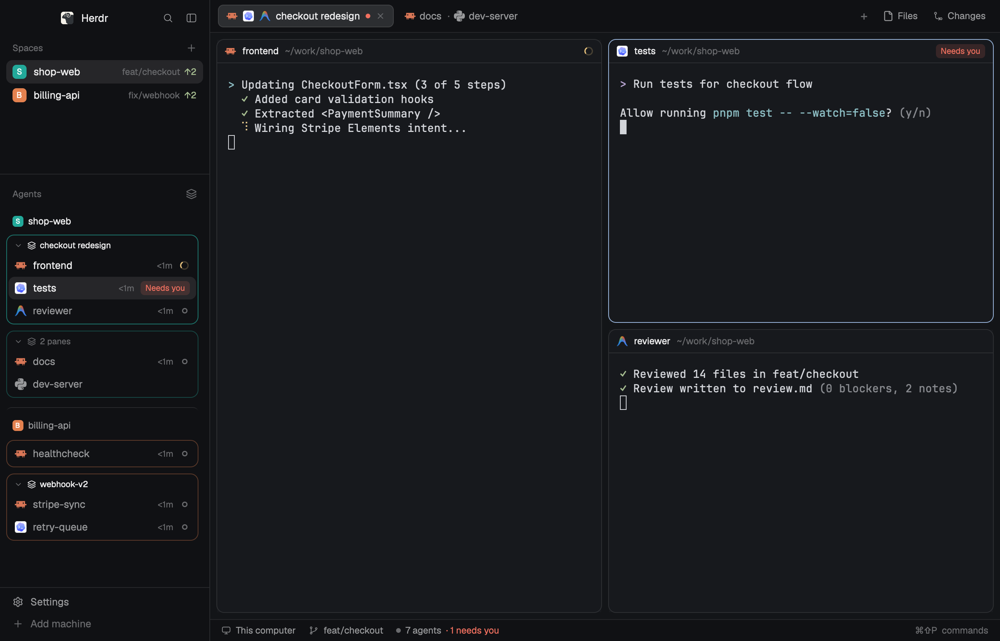
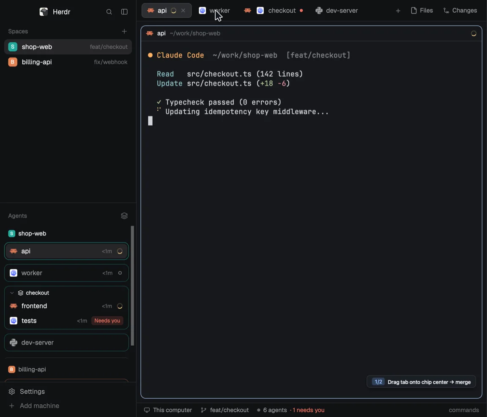
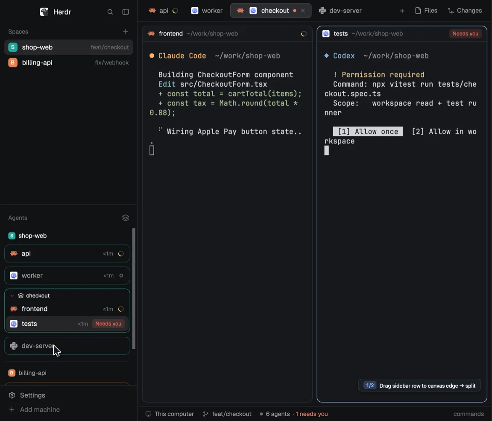
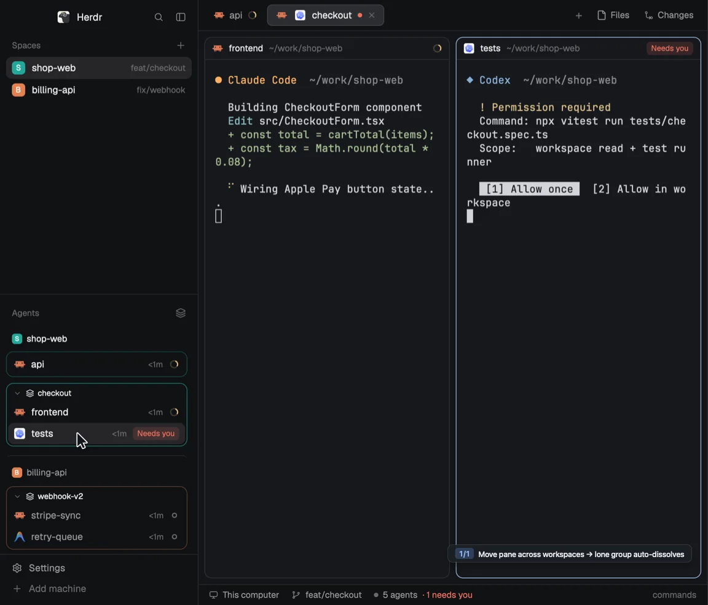
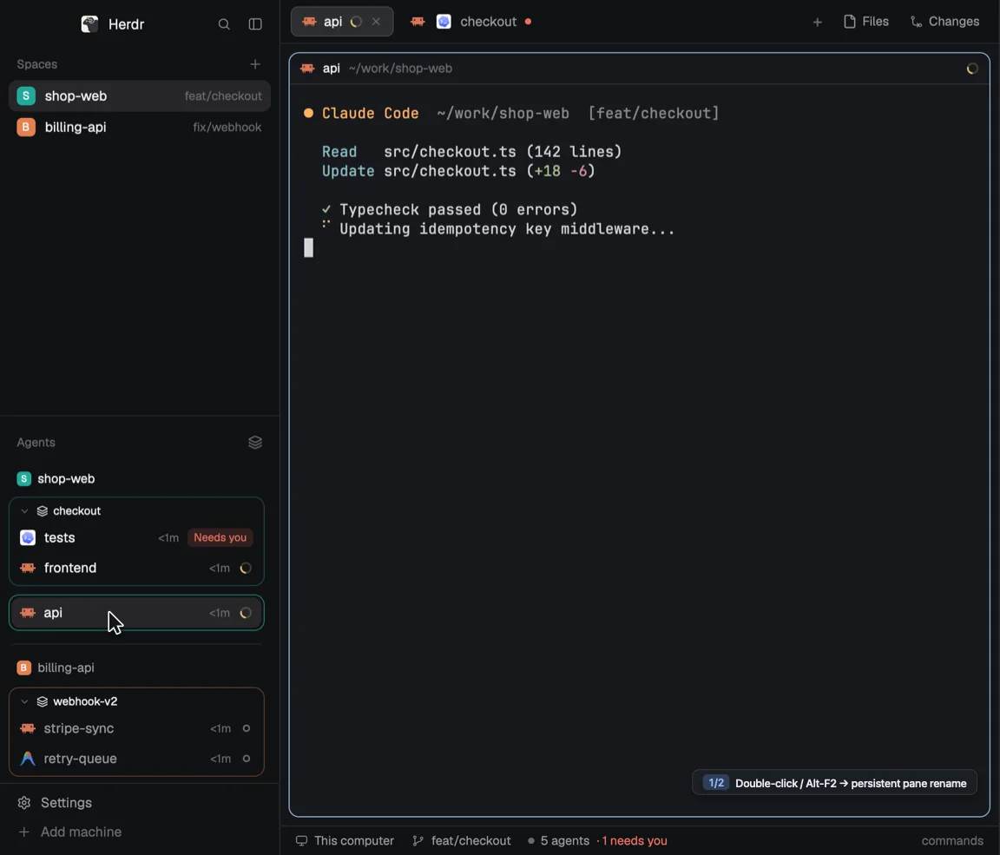
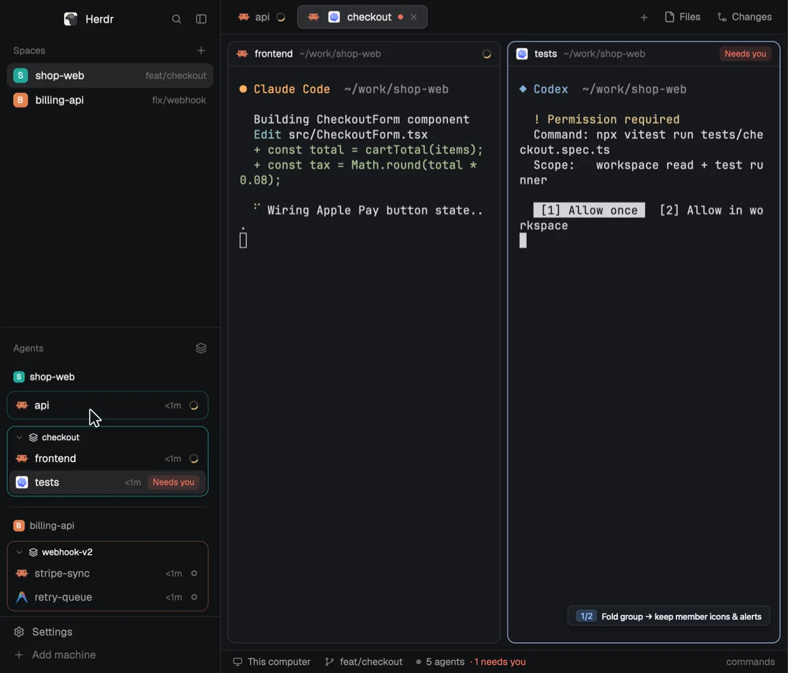
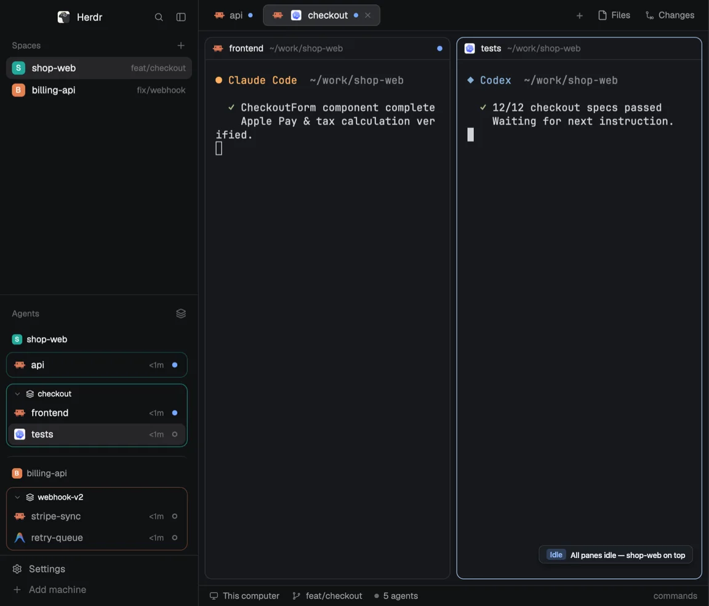

<div align="center">

# Herdbook

**See your entire Herdr window as `Workspace → Tab Group → Pane` — drag anything anywhere, persist every name across restarts, and watch attention flow to the top.**


**English** · [简体中文](#简体中文) · [Install](#install) · [Drag Everywhere](#1-drag-everything-everywhere) · [Naming & Folding](#2-persistent-naming--folding) · [Status Bubbling](#3-three-level-attention-bubbling) · [Cheat Sheet](#interaction-cheat-sheet) · [Mod Suite](#ecosystem--tabs-row-co-existence)



<table>
  <tr>
    <td width="33%" valign="top">
      <a href="#1-drag-everything-everywhere"><b>1. Drag Everything Everywhere</b></a><br />
      Merge, split, reorder, and migrate panes or tabs directly with your mouse across the top bar, sidebar, and canvas.
    </td>
    <td width="33%" valign="top">
      <a href="#2-persistent-naming--folding"><b>2. Naming &amp; Folding</b></a><br />
      Name any pane or group with 3-surface live sync, and fold groups or workspaces while keeping status alerts visible.
    </td>
    <td width="33%" valign="top">
      <a href="#3-three-level-attention-bubbling"><b>3. 3-Level Status Bubbling</b></a><br />
      Real status changes lift <code>Pane → Group → Workspace</code> in <b>Agents</b> while <b>Spaces</b> and top tabs stay fixed.
    </td>
  </tr>
</table>

</div>

## Install

> [!TIP]
> Tell your Herdr agent:
> **`Add the Herdbook layout from github.com/zylbeyondlimits/herdr-herdbook`**

It copies `layouts/herdbook.json` and the six `mods/herdbook-*` folders into `~/.config/herdr-app`, merges `keys.json` (`Alt-F2` → `mod.open:herdbook-rename`), verifies each mod, and activates `herdbook`.

- **Non-destructive:** `main` and all custom layouts stay intact — press **`Ctrl+Shift+L`** anytime to cycle back.
- **Modular:** every `herdbook-*` mod works independently (`herdbook-agents`, `herdbook-tabs`, `herdbook-spaces`, `herdbook-pane`, `herdbook-menu`, `herdbook-rename`).
- **Zero dependencies:** runs offline on **official Herdr 0.1.16+** across macOS, Linux, and Windows.

## Why Herdbook?

| | Stock Herdr (`main`) | **Herdbook** |
|---|---|---|
| **Rearranging** | Commands and shortcuts | **Mouse / trackpad drag-and-drop everywhere** — top bar, sidebar tree, workspaces, and split canvas; single-pane groups auto-dissolve |
| **Naming & Folding** | Ephemeral tab titles | **Persistent pane & group names** synced across tab bar, pane headers, and sidebar tree, plus **group & workspace folding** with live status badges |
| **Attention** | Fixed order, or flat urgency sort | **3-level status bubbling (`Pane → Group → Workspace`)** in **Agents** while **Spaces** and the top tab bar stay put |
| **Sidebar view** | Lists agents reporting status | **Full `Workspace → Tab Group → Pane` tree**, including shells, editors, mod panes, and sub-agents |
| **Tab bar** | One pill per tab | **Every pane's icon & name inside multi-pane pills** — click any segment to focus, or drag it out on its own |

---

## 1. Drag Everything Everywhere

Drag any **pane**, **tab group**, or **workspace** smoothly across all four surfaces (**Spaces**, **Agents**, **Top Tab Bar**, and **Pane Headers**).

> [!NOTE]
> **Dual drag engine & trackpad stability:** official **Herdr 0.1.16+** runs on a pure-JS cross-panel engine (`shared("herdbook.drag")`) with automatic stale-drag cleanup; builds with native drag APIs automatically add floating drag previews and 4-edge split overlays. Long lists preserve exact viewport scroll offsets during presses and drags, with smooth edge auto-scroll.

### 1.1 Merge & split right inside the top tab bar

<p align="center">
  
</p>

| Gesture | Result |
|---|---|
| Drag a single-pane chip (or grouped pane segment) → **target chip center (~56%)** | **Merges in place** side by side into one tab group without leaving the top bar |
| Drag any pane segment → **blank top-bar strip** or **chip left / right edge (~22%)** | **Splits out** into its own standalone tab at the end of the workspace or at that exact slot |
| Drag a full tab pill → **neighbor edge or gap** | **Reorders** tabs cleanly within the current workspace |

### 1.2 Split & rearrange across sidebar and canvas

<p align="center">
  
</p>

| Gesture | Result |
|---|---|
| Drag from **Agents** (or a pane header) → **canvas pane / split edge** | Splits the pane into multi-pane layouts (`right` / `down`) and updates the group immediately |
| Drag a **pane header** → **sidebar gap, group card, or top tab bar** | Splits back out into its own tab or moves cleanly into another group |

### 1.3 Move across workspaces & auto-dissolve lone groups

<p align="center">
  
</p>

| Gesture | Result |
|---|---|
| Drag any pane / tab group → **another workspace** in **Spaces** or **Agents** | Migrates across workspaces immediately (local and remote machines stay isolated) |
| Drag workspace cards in **Spaces** or headers in **Agents** | Reorders projects manually without worktree auto-snap snapping back |
| Shrink a 2-pane group down to **1 pane** | **Auto-dissolves** the stale group frame and name (`tab.rename { name: "" }`), leaving a plain draggable pane card |

---

## 2. Persistent Naming & Folding

### 2.1 Name any pane or group — synced across every surface

<p align="center">
  
</p>

| Action | Behavior |
|---|---|
| **Rename pane** (`Double-click`, right-click → **Rename pane**, or **`Alt-F2`**) | Opens `Rename pane` dialog and syncs live across **pane header**, **top-bar segment**, and **sidebar row** |
| **Cross-restart & cross-space persistence** | Writes terminal label `pane-name` via `hc label` (and uses native `pane.rename` on Herdr 0.1.17+, supporting mod panes too) |
| **Rename group** (`Double-click` group header or top-bar pill) | Names any 2+ pane group (e.g., `payments`) and syncs between top tab bar and **Agents** tree |

### 2.2 Fold groups & workspaces without losing status

<p align="center">
  
</p>

| Control | Behavior |
|---|---|
| **Group chevron (`v` / `>`)** | Collapses a multi-pane group into one compact summary line keeping **member icons**, **count**, and active **`Needs you` / dot badges** |
| **Workspace header** | Folds or unfolds an entire repository section cleanly to focus only on active work |
| **Sidebar toggle** (top-left) | Shrinks the sidebar down to a compact icon rail (`44px` / `76px` on macOS) and restores exact width on reopen |

---

## 3. Three-Level Attention Bubbling

<p align="center">
  
</p>

In **Agents** (`Grouped by workspace`), real pane status changes automatically bubble attention upward across all three tiers:

1. **Pane** lifts to the top of its group (`retry-queue` above `stripe-sync`)
2. **Group** lifts to the top of its workspace (`webhook-v2` at the top of `billing-api`)
3. **Workspace** lifts to the top of **Agents** (`billing-api` above `shop-web`)

| Trigger | Behavior |
|---|---|
| Agent starts working, finishes, or needs input | Lifts **Pane → Group → Workspace** to the top of **Agents** |
| Clicking / viewing a finished pane (`done → idle`) | **Never jumps** — prevents jarring reorders while you review output |
| Manual drag reorder | **Stays put** at your exact drop slot until the next real status transition |
| **Spaces** & **Top Tab Bar** | Always preserve fixed spatial order so repos and tabs never teleport under your cursor |
| **Priority** toggle (**Agents** header icon) | Switch anytime to a flat urgency list (`Needs you → Done → Working → Idle`) |

---

## Interaction Cheat Sheet

| Target | Click | Double-click | Hover `+` | Drag | Right-click / Key |
|---|---|---|---|---|---|
| **Workspace** | Fold / unfold | — | New tab (or Launch Menu) | Reorder workspaces; drop zone for panes & tabs | Rename, worktrees, close |
| **Tab group** (2+ panes) | Fold chevron collapses; row focuses pane | Rename tab group | Split pane right | Reorder, join panes, or move workspace | Tab menu, move to space |
| **Pane** (row or header) | Focus pane | **Rename pane** | Split right | Merge into tab, split out, move workspace | `Alt-F2` rename, pin, **Move to space…**, close |
| **Top-bar chip** | Select tab (segment focuses pane) | Rename tab | — | **Center (~56%):** merge · **Edges (~22%):** split / reorder · **Blank strip:** split to workspace end | Tab menu; `+` opens Launch Menu / New menu |

## Ecosystem & `tabs-row` Co-existence

<p align="center">
  
</p>

| Mod | Description |
|---|---|
| [herdr-herdbook](https://github.com/zylbeyondlimits/herdr-herdbook) | Workspace → Tab Group → Pane tree, pane/group naming & folding, drag-and-drop everywhere, 3-level bubbling |
| [herdr-usage-meter](https://github.com/zylbeyondlimits/herdr-usage-meter) | Live AI subscription and quota meter inline beside the tab bar |
| [herdr-launch-menu](https://github.com/zylbeyondlimits/herdr-launch-menu) | Customizable `+` agent launcher with ordering, flags, and per-agent permission toggles |
| **Frost** *(coming soon)* | Adjustable frosted-glass window blur with lossless layout restore |

When [Launch Menu](https://github.com/zylbeyondlimits/herdr-launch-menu) (`mods/launch-menu`) is installed, the top-bar `+` and workspace hover `+` open it automatically instead of `new-menu`. `herdbook-tabs` also tightens its right padding to `3px` automatically when mounted beside siblings inside `tabs-row`.

<details>
<summary>Show <code>tabs-row</code> layout snippet (top bar + Usage Meter + Frost)</summary>

```json
{
  "id": "tabs-row",
  "type": "row",
  "size": { "px": 42 },
  "resizable": false,
  "window_drag": true,
  "children": [
    { "id": "tabs", "type": "block", "size": { "weight": 1 }, "window_drag": true, "content": { "mod": "herdbook-tabs" } },
    { "id": "frost", "type": "block", "size": { "px": 77 }, "window_drag": true, "content": { "mod": "frost", "props": { "block": "frost" } } },
    { "id": "usage", "type": "block", "size": { "px": 78 }, "window_drag": true, "content": { "mod": "usage-meter", "props": { "block": "usage" } } }
  ]
}
```

</details>

<details>
<summary>What Herdbook writes &amp; reads (zero network, local only)</summary>

- Writes one terminal label, `pane-name`, via `hc label <terminal> pane-name=<name>` (clear with `hc label t3 pane-name=`), plus native `pane.rename` when Herdr 0.1.17+ exposes it.
- Writes `tab.rename { id, name: "" }` only to clear the stale name of a group that shrank to one pane.
- Uses `shared("herdbook.drag")` transiently during pointer drags on official builds without native `startDrag`.
- Stores display order and fold state (`treeOrder`, `groupsFolded`, `spacesFolded`) in each mod's own `localStorage`.
- Runs `git rev-parse` inside a space's folder for branch / ahead counts and worktree menu items, matching Herdr's shipped `spaces` and `menu` mods.
- Reads only `mod.json` under `appHome()/mods/` to detect optional sibling mods (`herdbook-menu`, `herdbook-rename`, `launch-menu`).

</details>

<details>
<summary>Tests &amp; Maintenance (42-test Node suite + <code>sync-drag.sh</code>)</summary>

```sh
./tests/run.sh
```

Runs **42 tests** (`tests/drag.test.mjs`, `tests/scroll.test.mjs`, `tests/groups.test.mjs`, `tests/move.test.mjs`, `tests/names.test.mjs`, `tests/rename.test.mjs`) and asserts byte-for-byte parity across the four `mods/*/drag.js` copies (`herdbook-agents`, `herdbook-tabs`, `herdbook-pane`, `herdbook-spaces`). After editing `mods/herdbook-agents/drag.js`, run `./scripts/sync-drag.sh`.

</details>

---

## 简体中文

**Herdbook** 为 Herdr 带来直观的可视化与鼠标拖拽体验：将整个窗口呈现为清晰的 **`工作区 → 标签组 → 窗格`** 三层结构，支持跨全区域拖拽重排、Pane / Group 持久命名与折叠，并在窗格状态变化时自动三级冒泡置顶。

### 1. 全区域鼠标拖拽
- **顶栏内直接拆合：** 拖住单窗格胶囊或分组内的窗格片段移至目标胶囊**中心（约 56%）**即可合并成组；拖向**顶栏右侧空白区**或其他胶囊**左右缘（约 22%）**即可拆成独立标签。
- **边栏 ↔ 画布分屏：** 从 `Agents` 拖向主画布边缘即可分屏，或从窗格标题栏拖回边栏间隙 / 顶栏恢复独立标签页。
- **跨工作区迁移与自动解散：** 拖入另一个 Workspace 即可跨项目迁移（本地与远程节点隔离）；仅 2+ 窗格显示组框，缩回 1 个窗格时自动清空旧组名与折叠状态并还原为普通卡片。
- **双引擎与触控板优化：** 官方 Herdr 0.1.16+ 开箱即用（`shared("herdbook.drag")` 纯 JS 协同）；长列表按住拖拽稳固锚定视口，不跳回顶部。

### 2. Pane / Group 持久命名与折叠
- **三处实时同步：** 双击窗格标题 / 侧栏行、右键 **Rename pane** 或按 **`Alt-F2`** 重命名窗格（写入 `pane-name` 标签，重启及跨工作区迁移持久保留，Herdr 0.1.17+ 自动启用原生 `pane.rename`）；双击组头或顶栏胶囊即可命名标签组，**顶栏、窗格与侧栏**三处实时联动。
- **折叠保留状态感知：** 折叠 Group 后仍显示成员图标、数量及 `Needs you` 提示；点击 Workspace 标题可整区收起/展开，聚焦当前项目。

### 3. 状态变化三级联动置顶（`Pane → Group → Workspace`）
- **实态冒泡：** 窗格状态变化时自动执行 **`Pane` 升至组内首位 → `Group` 升至工作区首位 → `Workspace` 升至 Agents 顶部**。
- **稳态不乱跳：** 点击查看已完成的窗格（`done → idle`）不触发跳动；手动拖拽位置保留到下次状态变化；左上角 **Spaces** 与顶部 **Tabs** 始终维持固定顺序；也可一键切换 **Priority** 优先级视图。

| 对象 | 单击 | 双击 | 悬停 `+` | 拖拽 | 右键 / 快捷键 |
|---|---|---|---|---|---|
| **工作区** | 折叠 / 展开 | — | 新建标签（或 Launch Menu） | 调整顺序；也是窗格与标签的投放区 | 改名、Worktree、关闭 |
| **标签组**（2+ 窗格） | 折叠箭头收起 / 展开 | 重命名标签组 | 向右分屏 | 排序、合并、迁移到其他工作区 | 标签菜单、移动到工作区 |
| **窗格** | 聚焦窗格 | **重命名窗格** | 向右分屏 | **并入标签 / 拆为独立标签 / 跨工作区移动** | `Alt-F2` 改名、置顶、移动、关闭 |
| **顶栏胶囊** | 切换标签（点片段聚焦窗格） | 重命名标签 | — | **中心：** 合并 · **左右缘 / 右侧空白：** 拆分 / 排序 | 标签菜单；`+` 打开 Launch / New 菜单 |

安装只需对你的 Herdr agent 说：「`Add the Herdbook layout from github.com/zylbeyondlimits/herdr-herdbook`」（随时按 `Ctrl+Shift+L` 无损切回原布局）。

<p align="right"><a href="#herdbook">↑ Back to top / 返回顶部</a></p>

## License

MIT for `herdbook-rename`, `drag.js`, `layouts/herdbook.json`, `scripts/`, and `tests/`. `herdbook-pane`, `herdbook-tabs`, `herdbook-agents`, `herdbook-spaces`, and `herdbook-menu` are modified copies of Herdr's `pane`, `tabs`, `agents`, `spaces`, and `menu` mods and stay under Apache 2.0 (see each folder's `LICENSE` and `NOTICE`).
