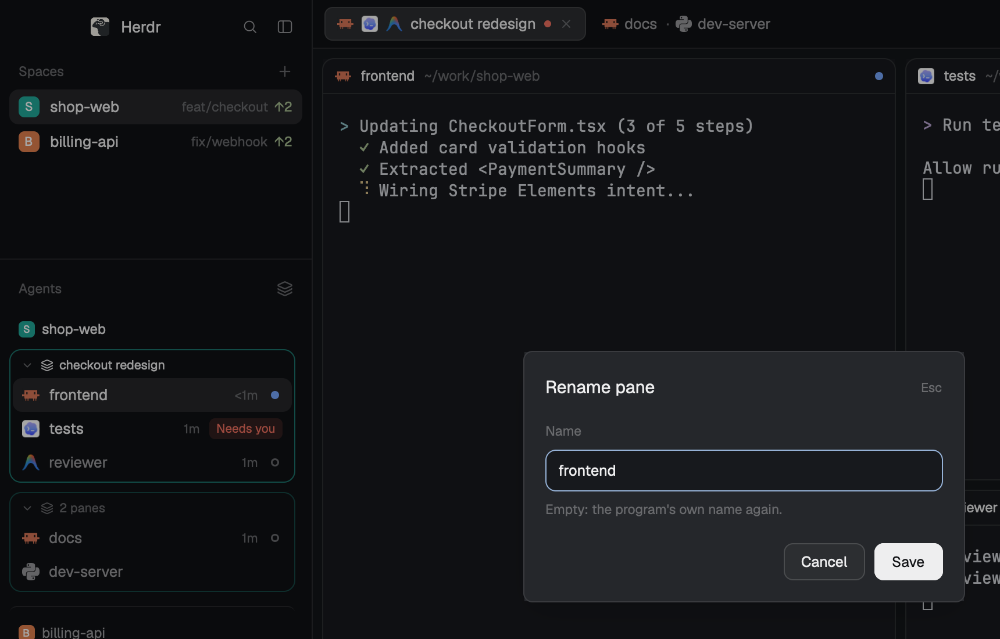
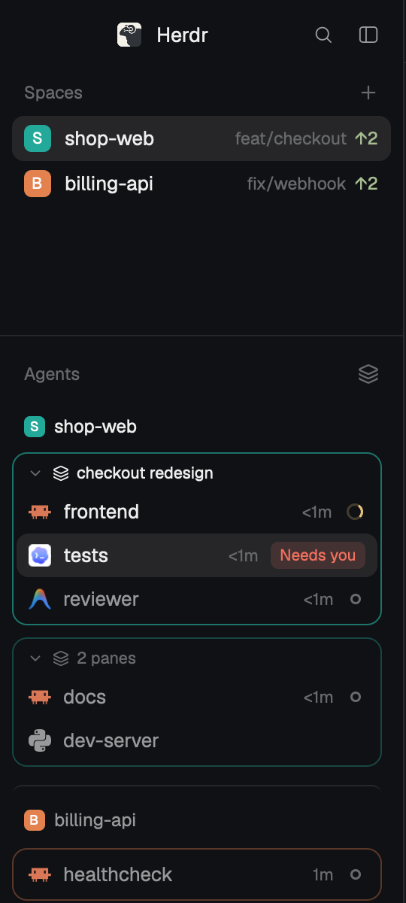
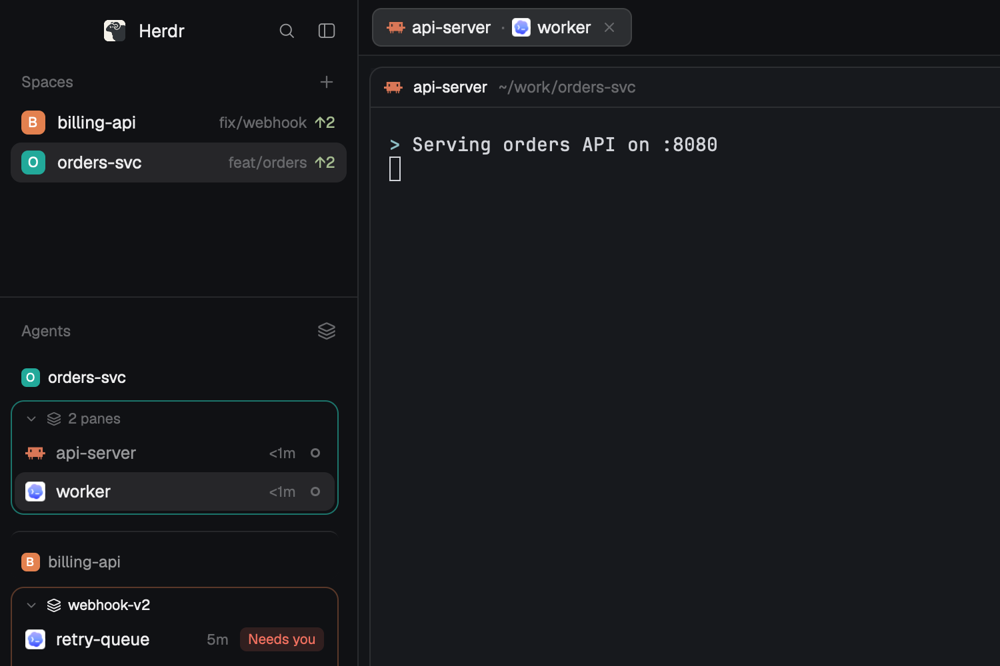

<div align="center">

# Herdbook

**See your whole Herdr window as Workspace → Tab → Pane — name every pane, watch attention flow to the top, and drag anything anywhere.**

**English** · [简体中文](#简体中文) · [Install](#install) · [Visual Tour](#visual-tour) · [Cheat Sheet](#interaction-cheat-sheet) · [Mod Suite](#co-existence-in-tabs-row)


</div>

## Install

Tell your Herdr agent:

> Add the Herdbook layout from github.com/zylbeyondlimits/herdr-herdbook

It copies `layouts/herdbook.json` and the six `mods/herdbook-*` folders into `~/.config/herdr-app`, merges `keys.json` (`Alt-F2` → `mod.open:herdbook-rename`), checks each mod, and switches to `herdbook`.

- **Non-destructive:** your own layout (`main` or any custom one) is untouched. Press **`Ctrl+Shift+L`** anytime to cycle back.
- **Modular:** every mod degrades gracefully on its own. Drop `herdbook-agents`, `herdbook-tabs`, `herdbook-spaces` or `herdbook-pane` into your own layout, set `"terminal_menu": "herdbook-menu"` on the layout root, and add `herdbook-rename` for the rename dialog.
- Works out of the box on **official Herdr 0.1.16+** (macOS, Linux, Windows). No network access.

## Why Herdbook?

| | Stock Herdr (`main`) | **Herdbook** |
|---|---|---|
| **Naming** | Tab and space names | **Every pane gets a persistent name** (`Alt-F2`, double-click, right-click) that survives restarts and moves between workspaces |
| **Sidebar view** | Lists agents that report a status | **Full `Workspace → Group → Pane` tree**, including plain shells, editors and mod panes |
| **Attention** | Fixed order, or sorted by urgency | **Status changes lift pane → group → workspace** to the top of the list while `Spaces` and the tab bar stay put |
| **Tab bar** | One pill per tab | **Each pane's icon and name inside the pill**, every segment clickable and draggable |
| **Rearranging** | Commands and shortcuts | **Mouse / trackpad drag-and-drop everywhere**; a group that shrinks to one pane dissolves by itself |

## Visual Tour

### 1. Three clear layers and persistent pane names



- **Pane:** every terminal, coding agent or mod pane. Double-click a pane header or sidebar row, right-click → **Rename pane**, or press `Alt-F2`. The name is stored as the terminal label `pane-name` (`hc label t3 pane-name=api`), and Herdr 0.1.17's native `pane.rename` is used automatically when the host has it (including non-terminal mod panes).
- **Tab group:** one or more panes on screen together. In the top bar it lists every pane's icon and name separated by `·`; in the **Agents** tree it is a space-tinted rounded card with a fold chevron, hover `+` (split right) and a right-click tab menu.
- **Workspace:** a collection of groups, with its git branch and `↑ahead` in **Spaces** and a hover `+` for a new tab (or [Launch Menu](https://github.com/zylbeyondlimits/herdr-launch-menu) when installed).

### 2. Attention flows to the top — pane → group → workspace



When a pane's status changes (`idle → working`, `working → blocked`, `working → done`, …), it jumps to the top of its group, the group to the top of its workspace, and the workspace to the top of **Agents**. Looking at a finished pane (`done → idle`) never lifts it. Where you drop things by hand stays put until the next status change; **Spaces** and the tab bar keep their fixed order. Prefer urgency? Switch **Agents** to **Priority** (`Needs you → Done → Working → Idle`) from the icon in its header.

### 3. Real groups, auto-dissolve, and drag-and-drop everywhere



- A group header appears only while a tab holds **2+ panes**. Name it (double-click), and the top bar shows its icons plus the name. When it shrinks to one pane, the stale name is cleared and it becomes a plain card you can drag straight out.
- **Drag any pane** (pane header, top-bar segment, single-pane tab, or sidebar row) onto another pane, the center of a tab chip or group header (to merge), the edges of a tab chip, the blank space of the top bar, or the gap between sidebar groups (to split into its own tab), or another workspace. **Drag any tab** to reorder or move it, and **any workspace** to reorder within its machine.
- **Dual engine:** official Herdr uses a pure-JS cross-panel drag (`shared("herdbook.drag")`) with stale-drag cleanup; builds with native drag APIs automatically get floating drag cards and 4-edge split previews.
- **Trackpad-friendly:** constant-height gap hit zones, viewport-anchored scrolling (pressing or dragging halfway down a long list never jumps to the top) and deliberate edge auto-scroll.

## Interaction Cheat Sheet

| | Click | Double-click | Hover `+` | Drag | Right-click / key |
|---|---|---|---|---|---|
| **Workspace** (header) | Fold / unfold | — | New tab (or Launch Menu) | Reorder workspaces; drop target for panes and tabs | Rename, worktrees, close |
| **Tab group** (2+ panes) | Focus first pane | Rename tab | Split pane right | Reorder, join, or move to another workspace | Tab menu, move to space |
| **Pane** (row or header) | Focus | **Rename pane** | Split right | Merge into a tab, split into its own tab, move to a workspace | `Alt-F2` rename, pin, **Move to space…**, close |
| **Top-bar chip** | Select tab | Rename tab | — | Center merges single-pane tab / segment into target tab; edges reorder or split out; blank tab-bar space splits pane to end of workspace | Tab menu; `+` opens Launch Menu / New menu |

## Co-existence in `tabs-row`


- **Launch Menu:** when [Launch Menu](https://github.com/zylbeyondlimits/herdr-launch-menu) (`mods/launch-menu`) is installed, the top-bar `+` and the active workspace's hover `+` open it instead of `new-menu`.
- **Toolbar blocks:** replace the `"tabs"` block in `layouts/herdbook.json` with a `"tabs-row"` to mount inline buttons beside `herdbook-tabs` — [Usage Meter](https://github.com/zylbeyondlimits/herdr-usage-meter) today, Frost (coming soon). `herdbook-tabs` tightens its right padding to `3px` automatically whenever a visible sibling follows it in the row:

```json
{
  "id": "tabs-row",
  "type": "row",
  "size": { "px": 42 },
  "resizable": false,
  "window_drag": true,
  "children": [
    { "id": "tabs", "type": "block", "size": { "weight": 1 }, "window_drag": true, "content": { "mod": "herdbook-tabs" } },
    { "id": "frost", "type": "block", "size": { "px": 77 }, "window_drag": true, "content": { "mod": "frost", "props": { "block": "frost" } } },
    { "id": "usage", "type": "block", "size": { "px": 78 }, "window_drag": true, "content": { "mod": "usage-meter", "props": { "block": "usage" } } }
  ]
}
```

| Mod | Description |
|---|---|
| [herdr-herdbook](https://github.com/zylbeyondlimits/herdr-herdbook) | This repo: Workspace → Tab → Pane tree, pane names, drag-and-drop |
| [herdr-usage-meter](https://github.com/zylbeyondlimits/herdr-usage-meter) | Live AI subscription and quota meter beside the tab bar |
| [herdr-launch-menu](https://github.com/zylbeyondlimits/herdr-launch-menu) | Customizable `+` agent launcher with ordering, flags and per-agent permission toggles |
| **Frost** *(coming soon)* | Adjustable frosted-glass window blur with lossless layout restore |

## What it touches

- Writes one terminal label, `pane-name`, via `hc label <terminal> pane-name=<name>` (clear with `hc label t3 pane-name=`), plus `pane.rename` when Herdr 0.1.17+ exposes it.
- Writes `tab.rename { id, name: "" }` only to clear the stale name of a group that shrank to one pane.
- Uses `shared("herdbook.drag")` transiently during pointer drags on official builds without native `startDrag`.
- Keeps its display order and fold state in each mod's own `localStorage`.
- Runs `git rev-parse` in a space's folder for git status and worktree menu items, matching Herdr's shipped `spaces` and `menu` mods.
- Reads only `mod.json` under `appHome()/mods/` to detect optional sibling mods (`herdbook-menu`, `herdbook-rename`, `launch-menu`).

## Tests & Maintenance

```sh
./tests/run.sh
```

Runs the **42-test** Node suite (`tests/drag.test.mjs`, `tests/scroll.test.mjs`, `tests/groups.test.mjs`, `tests/move.test.mjs`, `tests/names.test.mjs`, `tests/rename.test.mjs`) and asserts byte-for-byte parity across the four self-contained `mods/*/drag.js` copies (`herdbook-agents`, `herdbook-tabs`, `herdbook-pane`, `herdbook-spaces`). When editing `mods/herdbook-agents/drag.js`, run `./scripts/sync-drag.sh` first.

## 简体中文

Herdbook 面向喜欢**图形化界面与鼠标/触控板直觉操作**的 Herdr 用户：把窗口整理成清晰的 **`工作区 → 标签组 → 窗格`** 三层结构，给每个窗格持久命名，让「需要你」的内容自动浮到最上面，并支持跨侧栏、顶栏、主屏随意拖拽。

- **窗格持久命名：** 双击窗格标题栏或侧栏行、右键 **Rename pane** 或按 `Alt-F2`，名字写入终端标签 `pane-name`（重启、跨工作区迁移都保留），Herdr 0.1.17+ 自动改用原生 `pane.rename`。
- **完整三层树：** 侧栏 **Agents** 的 `Grouped by workspace` 视图展示所有工作区、标签组和窗格（含普通终端、编辑器、Mod 窗格与子 Agent）；也可一键切到 **Priority** 视图（按 `Needs you → Done → Working → Idle` 排序）。
- **状态变化三级冒泡置顶：** 窗格状态变化时，窗格跳到组内最前，该组跳到工作区最前，该工作区跳到整个 Agents 列表最前；点开已完成的窗格（`done → idle`）不会触发跳动；手动拖拽的位置会保持到下一次状态变化；左上角 **Spaces** 与顶栏保持原有顺序。
- **真正的「组」：** 标签里有 2 个及以上窗格才显示组头（可折叠、可命名）；缩回 1 个窗格时自动清掉旧组名，变成可随意拖出的普通卡片。顶栏胶囊按分屏顺序显示每个窗格的图标和名字（`·` 分隔，每段都可单独点击或拖走）。
- **全区域拖拽（双引擎）：** 官方版 Herdr 0.1.16+ 开箱即用，支持在 Spaces、Agents、顶栏与窗格标题栏之间互拖：单窗格或组内片段拖到顶栏空白处/胶囊左右缘即可在当前工作区拆成独立标签，拖到另一颗标签中心即可直接合并成组，也可跨工作区迁移或排序；支持原生拖拽 API 的构建会自动升级为浮动拖拽卡片与四边分屏预览；触控板长列表滚动、按住拖拽不会跳回顶部。
- **自由组合：** 随时按 `Ctrl+Shift+L` 无损切回原布局；也可在 `tabs-row` 中与 Usage Meter、Launch Menu（以及即将发布的 Frost）并排使用。

| | 单击 | 双击 | 悬停 `+` | 拖拽 | 右键 / 快捷键 |
|---|---|---|---|---|---|
| **工作区** | 折叠 / 展开 | — | 新建标签（或 Launch Menu） | 调整顺序；也是窗格与标签的投放目标 | 改名、Worktree、关闭 |
| **标签组**（2+ 窗格） | 聚焦首个窗格 | 重命名标签 | 向右分屏 | 排序、合并、迁移到其他工作区 | 标签菜单、移动到工作区 |
| **窗格** | 聚焦 | **重命名窗格** | 向右分屏 | 合并进标签、拆成独立标签、移动到工作区 | `Alt-F2` 改名、置顶、移动到工作区、关闭 |

安装时对你的 Herdr agent 说：「Add the Herdbook layout from github.com/zylbeyondlimits/herdr-herdbook」。

## License

MIT for `herdbook-rename`, `drag.js`, `layouts/herdbook.json`, `scripts/`, and `tests/`. `herdbook-pane`, `herdbook-tabs`, `herdbook-agents`, `herdbook-spaces`, and `herdbook-menu` are modified copies of Herdr's `pane`, `tabs`, `agents`, `spaces`, and `menu` mods and stay under Apache 2.0 (see each folder's `LICENSE` and `NOTICE`).
