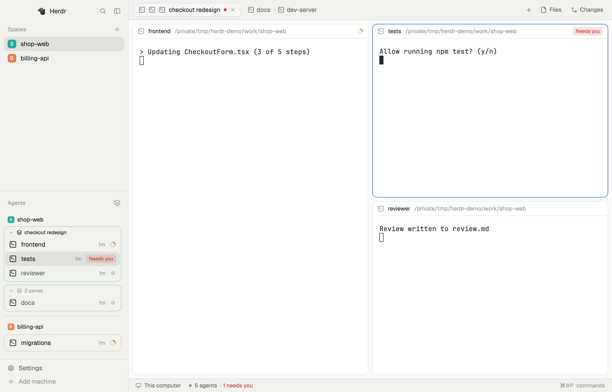

# Herdbook

Herdr's own window, with names for your panes and your tabs as groups. Every
pane can have a name you give it, and the name follows the terminal into the
pane's header, the tab bar and the Agents list. In the Agents list, each tab's
agents sit together in one rounded frame, tinted with the space's color, that
you can fold, rename or move to another space from a right-click.

## What you see

The layout is Herdr's `main` with four blocks swapped; everything not listed
here is Herdr's own.

- **Tab bar** (`herdbook-tabs`, 30px, `chrome`). A tab with one pane on screen
  looks like Herdr's: icon, then its label (max 170px), the pane's given name
  instead when it has one. A tab with several panes on screen lists each
  pane: its 14px icon and its name (max 96px each, truncated on its own),
  separated by a `dim` "·", in split order (left to right, top to bottom);
  the tooltip has every name. A tab someone named (not after its program),
  with several panes: every pane's icon first, then the tab's name; the
  tooltip lists the panes. Zoomed: only the zoomed pane, with " Z".
- **Pane headers** (`herdbook-pane`, Herdr's pane header): icon, the pane's
  name (14px icon, 12px `font_medium` `foreground`, max 260px), the folder in
  `dim`, the status. On hover the buttons are, in order: move to another
  space (`move-space.svg`, tooltip "Move to another space"), split right,
  split down, zoom, close.
- **Agents list** (`herdbook-agents`). The Priority view is Herdr's, with
  given names. In "Grouped by space":
  - Each space's header has a 14px rounded tile in the space's color
    (shared `space.colors`, Herdr's spaces list sets it) with the name's
    first letter in white 9px bold, then the space name in 12px semibold
    `foreground`. From the second space on, a 1px `border` line and 6px gap
    sit above the header.
  - Each tab is a frame: 2px padding, 3px above and below, 10px corners, a
    1px border in the space's color at 35% (`#rrggbb59`). Its header (20px,
    10.5px text, 6px corners) has a fold chevron (11px), a `layers.svg`
    icon, and the tab's name in `font_medium` `foreground` when someone named
    it, else "N panes" in `dim`. A tab with one pane and no name has a frame
    and no header.
  - Folded, the header is 26px and 12px, `foreground`, and shows each agent's
    13px icon, the count when more than one, and the most urgent status.
    `selected` background when one of its agents is focused.
  - Rows in a frame name their pane: the given name, else the agent's own
    title, else its program; two that read the same get numbers in split
    order ("zsh 1", "zsh 2").
  - The list has 14px padding on the right so frames clear the scrollbar.
- **Terminal and list menus** (`herdbook-menu`, popup 228×320, `popover`).
  Herdr's menu plus "Rename pane" (`square-pen.svg`), "Move to space…" (a
  `chevron-right` submenu), and on agent rows "Rename group". The move list
  has a "Move to space" header with a back chevron, one row per other space
  on the same machine (a 16px tile in its color with its first letter),
  then a divider and "Move to new space" (`folder-plus.svg`). More than six
  rows scroll (224px).
- **Rename dialog** (`herdbook-rename`, dialog 380px wide, 18px padding,
  `popover`): "Rename pane" 15px semibold, "Esc" hint, a "Name" label, a
  36px input (9px corners, `accent` border while focused, `background`
  fill), "Empty: the program's own name again." in `dim`, then Cancel and
  Save (32px, 8px corners; Save is `solid` / `solid_foreground`).

## How it behaves

- A pane's name is its terminal's `pane-name` label in herdr-core. It stays
  with the terminal through restarts and moves; `hc label t3 pane-name=api`
  sets it from a shell, `hc label t3 pane-name=` clears it.
- Renaming: double-click a pane header, "Rename pane" in the right-click
  menu of a pane, a terminal or an Agents row, or Alt-F2 (`keys.json`,
  `mod.open:herdbook-rename`) for the focused pane. The dialog opens with the
  current name selected; Enter or Save writes it (spaces collapsed, trimmed),
  Esc or Cancel closes. Empty goes back to the program's name. A failed
  write shows an error toast with `hc`'s message.
- Groups are tabs. "Rename group" (agent row menu) and a double-click on a
  frame header run `tab.rename`, which asks for the name. A single click on
  a frame header focuses the tab's first pane. Right-click a frame header for
  the tab menu.
- The chevron folds a frame; folds are kept across restarts (localStorage
  `groupsFolded`, per copy of the mod).
- Order in "Grouped by space": the space with the most recent agent state
  change comes first, and in a tab the agent that changed last comes first.
  Looking at a finished agent (done to idle) doesn't count. Ties keep
  Herdr's order. Tabs keep their order inside a space; the Spaces list keeps
  its own order. `setAgentOrder` follows the list, so `agent.next` does too.
- Statuses look as in Herdr: working a 12px spinning ring, blocked a "Needs
  you" badge (a "!" tile in compact spots), done a dot, idle a ring.
- Moving ("Move to space…", the header button, a tab's right-click): pick a
  space on the same machine or a new one. A pane moves alone; a tab moves
  with all its terminals, which land side by side in one tab with its name.
  The terminals keep running and keep their names. The target space is
  shown afterwards. If a step fails, the terminals go back to their own space
  and a toast says what failed.
- Without `herdbook-menu`, right-clicks on headers and rows do nothing, the
  move button is gone, and the tab bar opens Herdr's `menu`. Without
  `herdbook-rename`, double-click does nothing and "Rename pane" is gone.

## Built from

- `layouts/herdbook.json`: Herdr 0.1.16's `main`, with `"terminal_menu":
  "herdbook-menu"` on the root, `herdbook-agents` for the agents block,
  `herdbook-tabs` for the tabs block and `herdbook-pane` as the tab block's
  `content.pane.header.content.mod`. Spaces, files, changes,
  workspace-chrome and workspace-status are Herdr's.
- `herdbook-pane`, `herdbook-tabs`, `herdbook-agents`, `herdbook-menu`: Herdr's
  `pane`, `tabs`, `agents` and `menu` cloned with `mod.clone`, Apache 2.0
  (each has `LICENSE` and `NOTICE`). Pure logic sits in files without a
  `herdr` import so node can test them: `herdbook-tabs/names.js` (`chip`,
  `label`, `paneLabel`), `herdbook-agents/groups.js` (`groupedOrder`,
  `frameName`, `paneNames`), `herdbook-menu/move.js` (`moveTerminals`).
- `herdbook-rename`: new, MIT. `mod.json` `{ "place": "none", "overlay":
  { "kind": "dialog", "width": 380 } }`. Props `{ target: { pane, terminal } }`,
  or none for the focused pane. Writes with `hc(["label", terminal,
  "pane-name=<name>"])`.
- Reads: `terminals()[i].labels["pane-name"]`, `panes()`, `spaces()`,
  `agents()`, `focused()`, `shared("space.colors")`, `commands()`.
- The other four mods check whether the menu and rename mods are installed with
  `readTextFile(appHome() + "/mods/<name>/mod.json")` (null when missing).
- Moving: when `commands()` has `pane.move` and `tab.move` with a `space`
  argument (not in official 0.1.16), it runs those. Otherwise `move.js`:
  `terminal.park` each terminal and wait until its pane is gone; for a new
  space `space.new {folder, machine}` and wait until it's shown, else
  `space.select {id}` and wait until `focused().space` is the target;
  `terminal.keep` the first and wait until its pane is in the target space;
  `tab.rename` that tab (the moved tab's name, or `""`); `pane.focus` it and
  `terminal.keep {place: "right"}` each other one; close the extra shell tab
  `space.new` made. Every wait polls every 25ms for at most 2.5s. On failure
  it selects the source space and keeps each parked terminal there.
- Programs run: `git rev-parse` (Herdr's menu, for worktree items) and
  `hc label`. No network.

## Watch out

- `fs/promises` `exists` refuses paths outside the home folder in a mod
  ("outside every granted read root"); `appHome()` can be elsewhere
  (`HERDR_APP_HOME`). Use `readTextFile`, which returns null for a missing
  file.
- `openOverlay` for a mod that isn't installed still returns an id and adds
  an error to `herdr-app status`; check first instead of relying on it.
- `terminal.keep` names its new tab after the terminal's address ("t7").
  Rename it after keeping.
- `space.new` always makes a shell of its own; close that tab after the move.
- Don't call a method `close()` on a View for your own use: Herdr calls a
  View's `close(cx)` when the overlay goes.
- A park-and-keep move can't keep a tab's split layout: the panes land side
  by side. Herdr has no command to place a kept terminal under another one
  in a given spot.
- The move list only offers spaces on the target's own machine; a
  terminal can't change machines.
- Fold state is per copy (localStorage): another layout's agents block starts
  unfolded.
- These are copies: they won't pick up later changes to Herdr's mods.

## Done when

- `herdr-app check` passes for all five mods, and `tests/run.sh` passes.
- `hc label t3 pane-name=api` shows "api" in t3's pane header, its tab chip
  and its Agents row within a second; clearing it brings the program's name
  back.
- A tab with two panes shows both names in its chip; after `tab.rename` to
  "login fix" it shows both icons and "login fix".
- In "Grouped by space" each tab with agents is a frame in its space's color;
  folding one keeps it folded after the app restarts.
- On official Herdr 0.1.16: moving a pane to another space leaves it running
  there with its name, in a tab named by its number; moving a two-pane tab
  keeps both panes and the tab's name; "Move to new space" leaves one tab in
  the new space.
- With `herdbook-menu` and `herdbook-rename` removed, the other three mods
  check and run with no errors in `herdr-app status`.
